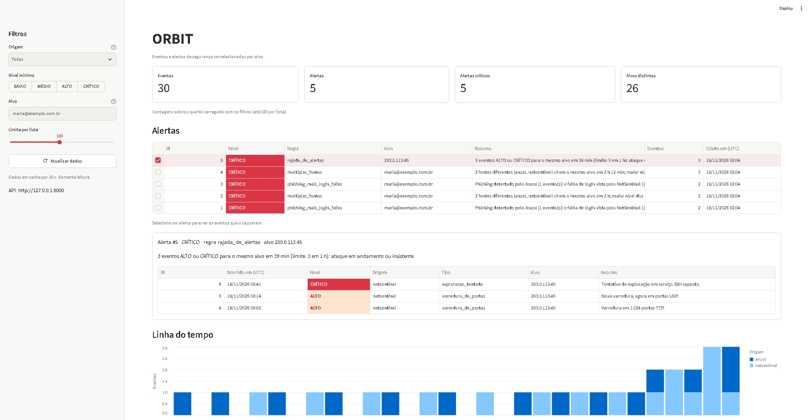

# ORBIT

Mini-SOC (centro de operações de segurança) próprio: recebe sinais de várias
fontes de segurança, guarda num formato único, correlaciona sinais do mesmo
alvo em alertas explicáveis e mostra tudo num painel web de uma tela só.

> **Estado: etapa 4 de 5 em andamento.** Parte 1 pronta: regra de saúde das
> fontes (heartbeat), ainda sem execução automática. Sem novas fontes nem IA.

## Roadmap

1. **Núcleo e banco**: API que recebe e lista eventos (NetSentinel e Anzol).
2. **Motor de correlação e níveis de risco**: regras fixas geram alertas.
3. **Painel web**: métricas, alertas, linha do tempo e filtros (só leitura).
4. Novas fontes: saúde das fontes (heartbeat), honeypot defensivo e scanner
   de segredos. ← aqui (parte 1: saúde das fontes)
5. IA que explica (e só sobe o risco), relatórios em PDF e alertas.

## Como funciona (etapa 3)

```
NetSentinel ─┐                                ┌─> eventos ─┐
Anzol ───────┼─ POST /eventos (X-API-Key) ─> API            ├─> PostgreSQL
(futuras) ───┘                                └─> correlação ─> alertas
                                               ^
     Painel (Streamlit) ── GET /eventos, GET /alertas, GET /alertas/{id}
```

- O formato do evento está em [docs/evento.md](docs/evento.md).
- As regras de correlação, a janela e o porquê de cada uma estão em
  [docs/correlacao.md](docs/correlacao.md). Resumo: phishing + login falho no
  mesmo alvo, rajada de eventos graves e múltiplas fontes viram alertas; o
  nível só sobe, nunca desce. Janela padrão de 24 h (`ORBIT_JANELA_HORAS`).
- O painel só lê a API (não acessa o banco nem altera regras). Detalhes em
  [docs/painel.md](docs/painel.md).
- **Saúde das fontes:** cada fonte manda eventos `heartbeat`. Sem sinal há
  mais de 3 h (`ORBIT_SILENCIO_HORAS`) vira alerta ALTO; regras com mais de 7
  dias (`ORBIT_DESATUALIZACAO_DIAS`) ou versão desconhecida, MÉDIO. Heartbeats
  ficam fora da correlação e ocultos no painel por padrão. Detalhes em
  [docs/saude_fontes.md](docs/saude_fontes.md).

## Rodar com Docker

```bash
cp .env.example .env      # edite e preencha a chave e a senha
docker compose up --build
```

- Painel: http://localhost:8501
- Documentação interativa da API: http://127.0.0.1:8000/docs

Os dois só escutam em `127.0.0.1` (o próprio computador).

## Rodar sem Docker (SQLite local)

```bash
python -m venv .venv
.venv\Scripts\activate           # Windows (Linux/macOS: source .venv/bin/activate)
pip install -r requirements-dev.txt
set ORBIT_CHAVE_API=minha-chave  # Windows (Linux/macOS: export ...)
uvicorn app.main:app --reload
```

Painel, em outro terminal (mesma chave; a API padrão é `http://127.0.0.1:8000`),
a partir da raiz do repositório:

```bash
set ORBIT_CHAVE_API=minha-chave
python -m streamlit run painel/app.py --server.address=127.0.0.1 --browser.gatherUsageStats=false
```

Use `python -m streamlit` (e não só `streamlit`) para o pacote `painel` ser
encontrado.

## Dados de demonstração

Envia ~35 eventos **fictícios** (e-mails em `exemplo.com.br`, IPs só das faixas
reservadas para documentação) que disparam os alertas de exemplo, mais
heartbeats de três sensores fictícios (um ok, um silencioso, um desatualizado). Pede
confirmação antes; não use contra um ORBIT de produção.

```bash
set ORBIT_CHAVE_API=minha-chave
python scripts/popular_demo.py
```
## Painel



*Dados de demonstração fictícios, gerados por `scripts/popular_demo.py`.*

## Exemplo de uso

```bash
curl -X POST http://127.0.0.1:8000/eventos \
  -H "X-API-Key: minha-chave" -H "Content-Type: application/json" \
  -d '{"origem":"anzol","tipo":"phishing_detectado","alvo":"maria@exemplo.com.br",
       "nivel":"CRÍTICO","resumo":"E-mail com DMARC falhando."}'

curl -H "X-API-Key: minha-chave" "http://127.0.0.1:8000/eventos?nivel_minimo=ALTO"

# Depois de um login falho do NetSentinel para o mesmo alvo, aparece o alerta:
curl -H "X-API-Key: minha-chave" "http://127.0.0.1:8000/alertas?nivel_minimo=ALTO"
```

## Testes

```bash
pytest
ruff check .
```

## Decisões de segurança

- **Falha fechada:** sem `ORBIT_CHAVE_API` configurada, a API recusa tudo (503).
- Chave comparada em tempo constante; segredos só em variáveis de ambiente.
- Entrada validada: campos extras recusados, tamanhos limitados, datas com fuso.
- No Docker, o banco não é exposto à rede; API e painel escutam só em `127.0.0.1`.
- Os contêineres rodam sem privilégios de root.
- O painel só lê; mostra todo texto vindo da API como texto puro (sem HTML nem
  Markdown), porque o resumo pode conter dados de terceiros. A chave nunca
  aparece na tela.

## Limites conhecidos (etapa 4, parte 1)

- **Saúde das fontes ainda não roda sozinha.** `verificar_saude` (em
  `app/saude_fontes.py`) existe e está testada, mas nada a chama
  periodicamente: os alertas de saúde ainda não são gravados nem aparecem em
  `GET /alertas` ou no painel. Precisa de agendamento, porque uma fonte calada
  não manda evento que dispare a verificação.
- Fonte que nunca mandou heartbeat é invisível para a regra; fonte desligada
  de propósito fica "silenciosa" para sempre (não há cadastro de fontes).
- O painel esconde heartbeats depois de receber a resposta da API (que não
  filtra por tipo): com muitos heartbeats, sobram menos eventos reais dentro
  do limite por lista.

- **Painel sem login próprio, uso local.** Quem abre o painel vê tudo o que a
  chave da API permite. Não publique a porta 8501 na rede.
- As métricas do painel contam o que foi carregado (até 200 por lista (padrão 100)), não o
  banco inteiro; a API ainda não tem endpoint de contagem.

- Uma única chave de API para todas as fontes (sem usuários nem papéis).
- Tabelas criadas na subida; falta migração (Alembic) para evoluir o banco.
  Num banco já existente, a tabela `alertas` é criada, mas eventos antigos com
  alvo em maiúsculas não são normalizados.
- Correlação roda dentro do `POST /eventos` (síncrona): um alvo com muitos
  eventos na janela deixa a requisição mais lenta. Não há fila nem limite de
  eventos por correlação.
- Quando um grupo de eventos cresce, nasce um alerta novo com o grupo maior
  (o antigo fica como histórico); para alvos muito ativos isso gera ruído.
- Tipos de login falho do NetSentinel ainda a conferir
  (`TIPOS_LOGIN_FALHO` em `app/correlacao.py`).
- Sem limite de requisições por fonte (rate limit).
- Sem HTTPS: pensado para uso local ou atrás de um proxy.

## Licença

MIT
